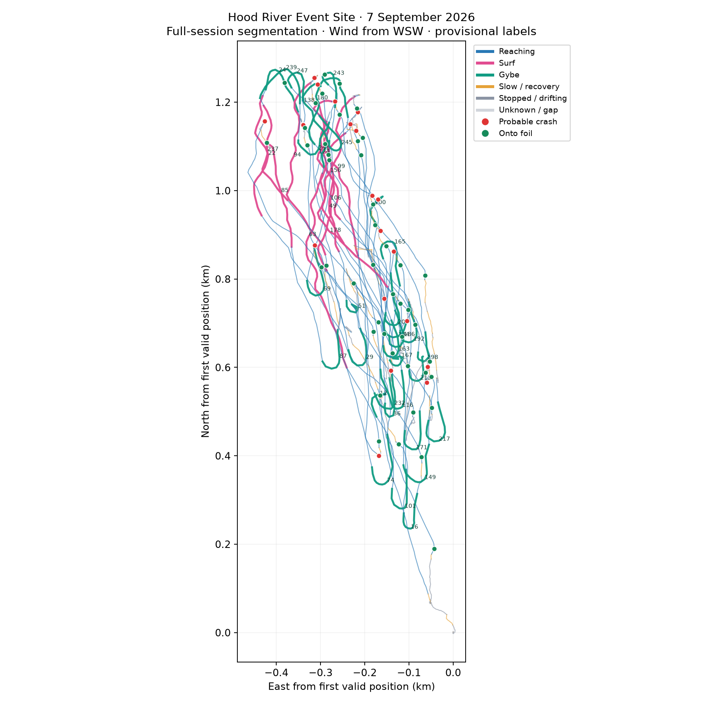
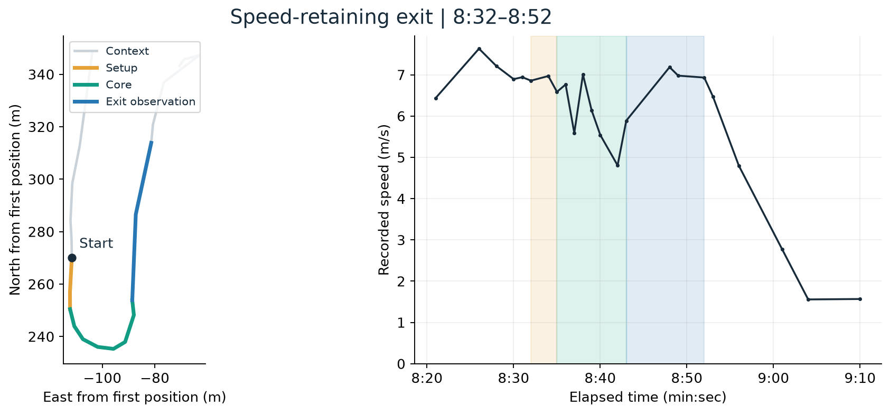
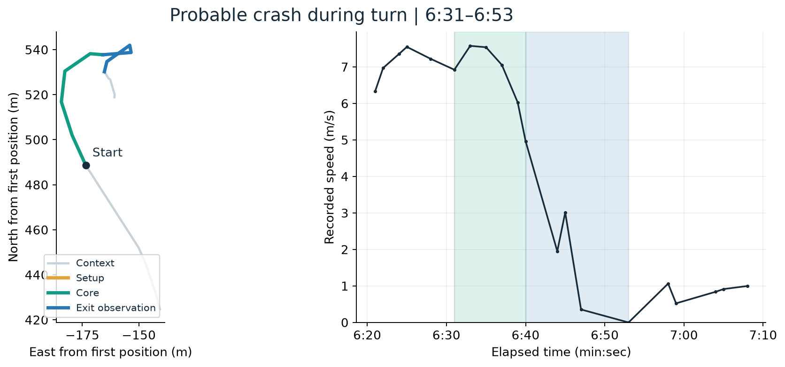
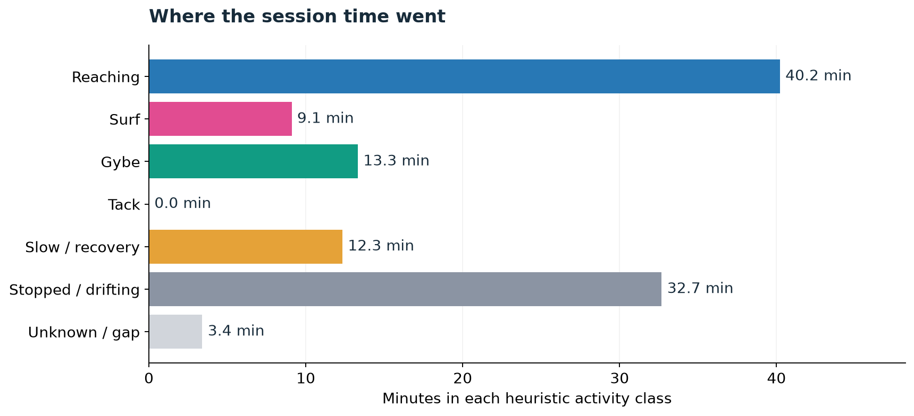
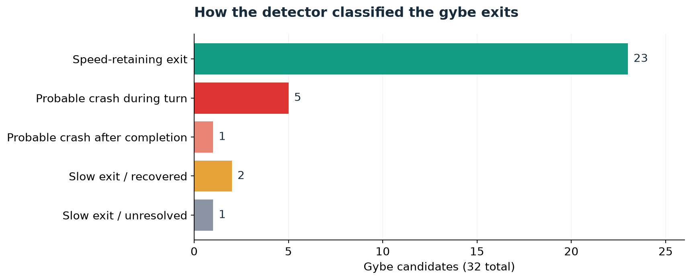
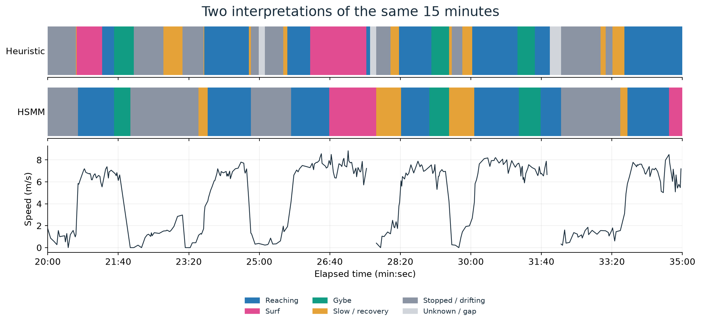

# Reading a wingfoil session as a sequence of maneuvers

*October 11, 2026 · Wingfoil Analyzer project notes*

A GPS track shows where a wingfoil session went. The questions I want to ask afterward are more specific: which turns kept their speed, where did a gybe break down, and which winding sections were sustained carving rather than repeated attempts to turn around?

Wingfoil Analyzer is an experiment in recovering that structure from a FIT activity recording. It currently combines a rule-based maneuver detector with an experimental hidden semi-Markov model, or HSMM. The rules produce the session report; the HSMM proposes a second interpretation of the activity states. The useful question now is whether that second interpretation improves on the first when a rider reviews the evidence.

## One real session, from track to maneuvers

This is the actual saved output from my September 7 session at the Event Site in Hood River. The colors show the heuristic activity labels; red dots mark probable crashes and green dots mark onto-foil candidates. The numbers identify segments in the report.



*The original analyzer map, with distances relative to the first valid GPS position. Labels are provisional; the plot does not establish whether every stop was a fall or every pink section was wave-powered surfing.*

[Explore the full clickable activity report →](https://davidingraham.github.io/WingFoilAnalyzer/examples/event-site-2026-09-07.html)

The report is the saved development output, including its track and event table. Click a track segment or table row to highlight it. Its “gybe success rate” label is the detector's speed-retaining-exit fraction, not validated recognition accuracy.

## Start with the information the recording actually contains

The prototype reads a FIT file, directly or inside a ZIP, retains recorded speed, and reconstructs course from trailing local fits to GPS position. A supplied wind direction gives the course a sailing context. In the development recording, wind from WSW is represented as 247.5 degrees true.

Course needs care at low speed. A small position error can look like a large turn when the rider is barely moving. The analyzer rejects unreliable course estimates and marks missing-position intervals and large gaps as unknown rather than filling the whole session with confident activity labels.

These are ground-track observations. They do not directly measure board attitude, wing handling, foil lift, or wave forces. A speed collapse can indicate a fall, but it can also be an intentional stop. Repeated crosswind carving can resemble surfing without proving that a wave supplied the power.

## The first useful model was a set of rules

The main detector looks for a stable approach followed by a meaningful course departure. It tracks the developing turn, uses the wind-relative geometry to distinguish gybe and tack candidates, and observes the exit after a completed side change. A wobble or hesitation stays inside the same maneuver instead of automatically becoming another turn.

Completion and outcome are separate. Crossing to the opposite travel side is a geometric completion; retaining speed through the exit is another question. A turn can complete and then end in a probable crash. Likewise, a low continuity score describes the observed course change, not necessarily a failed maneuver.

That initial stable-approach assumption misses some turns embedded in carving. A supplemental detector therefore looks for persistent travel-side changes even without a steady reach beforehand. Surf candidates are then split around protected maneuvers so the report can represent a sequence such as surf, gybe, surf.

The output is a contiguous session timeline, a clickable track report, and separate tables for maneuvers, probable crashes, and onto-foil candidates. Discrete crash events do not add duration to the timeline.

## Two turns, two different outcomes

A close-up makes the distinction between turning and retaining speed easier to see. Both examples below come from the recording and its saved phase boundaries. The left panel shows the ground track; the right shows recorded speed, with matching phase shading. These are new plots of the saved analysis and original samples, rather than screenshots of the report.



*At 8:32–8:52, the detector identifies a turn with speed retained through its exit window. Speed dips through the core and recovers to around 7 m/s. The later slowdown lies outside that window: the label describes the maneuver's observed exit, not the entire following ride.*



*At 6:31–6:53, speed collapses toward zero and the event is classified as a probable crash during the turn. The blue tail is the retrospective phase refinement's exit observation, not proof of a completed gybe. This example has Low confidence; GPS and speed alone cannot prove a physical fall.*

## What the development session says so far

The saved HSMM-mode run of the September 7, 2026 Event Site recording in Hood River contains the following **heuristic** results:

| Output | Recorded result |
| --- | ---: |
| Session duration | 6,663.117 seconds, about 1 hour 51 minutes |
| Contiguous duration segments | 267 |
| Gybe candidates | 32 |
| Tack candidates | 0 |
| Surf candidates | 11, totaling 546 seconds |
| Probable crash events across the session | 21 |
| Onto-foil candidates | 45 |

Of the 32 gybe candidates, 23 have speed-retaining exits, five have probable crashes during the turn, one has a probable crash after completion, two have slow but recovered exits, and one has an unresolved slow exit. The resulting 71.9% speed-retaining-exit fraction is a description of these detector outputs, **not a measured classification accuracy or a rider-confirmed gybe success rate**.

The supplemental detector recovered six completed turn candidates that the earlier approach missed. Those additions are useful review targets, not proof that every added event is correct. The absence of detected tacks is also not an independent test of tack recognition.



*The saved timeline expressed as time, rather than a count of GPS samples. Reaching accounts for 40.2 minutes; the detector labels another 9.1 minutes as surf candidates. These are the same intervals summarized in the table above.*



*The 32 gybe candidates split by detected outcome. The six crash-associated gybes are a subset of the 21 probable crashes across the whole session.*

## Why introduce an HSMM?

A maneuver unfolds over time. A setup, turn core, and exit have an order and a duration; treating every sample as an unrelated classification throws that structure away.

The current implementation expresses that idea as a constrained, flattened 19-state model:

- Stopped, Taxiing, and Unknown.
- Reach and Surf for each travel side relative to the wind.
- Gybe and Tack, each with Setup, Core, and Exit phases for each entry side.

The exported labels also provide a Foiling parent for the riding and maneuver states. This is the hierarchical part of the representation; the decoder itself searches the flattened state graph.

Seven features summarize speed, wind-relative course, turning, recent directional consistency, and speed relative to the recent history. Explicit truncated-lognormal duration priors express expectations about how long a state lasts. A beam search retains a limited set of possible state sequences as it processes the recording.

There is an important limitation: emission statistics are fitted from the heuristic labels of the same recording being decoded. The duration priors are hand-set defaults. The HSMM can impose useful temporal structure, but agreement with the rules is not independent validation. It may simply reproduce their mistakes.

For that reason, `--decoder hsmm` writes an additional state sequence. It does not replace the heuristic maneuver, crash, or foil-onset tables. The saved state's sample counts are also not state durations: the recording has irregular sample timing.



*The saved outputs aligned in elapsed time. HSMM travel sides and setup/core/exit states are collapsed into common activity colors for this comparison; each sample label extends to the next recorded timestamp. Short unknown and recovery intervals are handled differently, and some surf boundaries move. This is a visualization of disagreement, not evidence that either row is correct.*

## What comes next

The next milestone is a reviewable comparison, before adding more model complexity.

First, turn the static comparison above into a synchronized, interactive timeline in the track report that shows the heuristic interpretation beside the HSMM states. Make disagreements easy to inspect and let a rider correct event type, boundaries, outcome, and uncertainty. Prioritize the six recovered gybes, apparent surf sections, stops labeled as crashes, and low-confidence boundaries.

Second, collect reviewed sessions beyond the recording used for development. Include actual tacks, interrupted turns, intentional stops, and different wind and sampling conditions. Preserve uncertain labels rather than forcing every interval into a clean category.

Third, separate fitting from evaluation. Save a model fitted on development sessions, freeze its parameters, and compare it with the heuristic baseline on held-out sessions. Measure missed and extra events, boundary timing errors, and outcome agreement. Split by session so neighboring samples from the same maneuver cannot leak into both fitting and evaluation.

Only after that comparison should the HSMM take responsibility for the main event outputs. A watch implementation is a later milestone: the separate causal crash detector already records confirmation time, but full-session fitting and final-path decoding make the current HSMM an offline experiment. Prefix replay, detection delay, memory use, and long-gap handling still need explicit tests.

The project now has a working way to ask better questions of a session. The next step is to build the evidence that lets those answers be trusted.

## Try it and inspect the implementation

```sh
uv sync
uv run wingfoil-analyze your-activity.fit --out results --wind 247.5 --decoder hsmm
uv run python -m unittest discover -s tests -p 'test_*.py'
```

Set `--wind` to the wind **from** direction in degrees true for your session. The example value describes the development session, not a general default to trust elsewhere.

See the [project README](../README.md), [HSMM implementation](../src/wingfoil_analyzer/hsmm.py), and [next milestones](roadmap.md). The numerical example above comes from the locally retained development report; the selected track map, clickable report, and derived figures are published with permission. The raw FIT recording remains local. Synthetic tests check implementation behavior, not real-world recognition accuracy.
